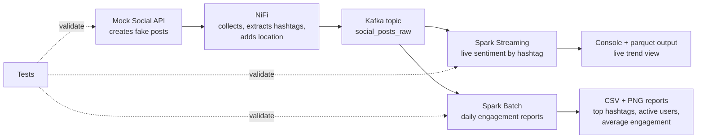

<!-- Mission: give the presenter a clear story, diagram, and talking points for teaching the pipeline to technical and non-technical classmates. -->
# Presentation Guide: Social Media Analytics Platform

## 1. Short opening

**Plain-language version**

Our project acts like a small social media monitoring system for a marketing agency. It watches fake live posts, finds hashtags, adds user location, measures sentiment, and creates reports about what topics and users are most active.

**Technical version**

The system simulates a streaming data pipeline: a Flask API produces JSON posts, NiFi ingests and enriches them, Kafka stores them as events, Spark Streaming performs near-real-time sentiment aggregation, and Spark Batch creates engagement reports from historical Kafka data.

## 2. One-slide pipeline diagram



Use this sentence while showing the diagram:

> "The same stream of posts feeds two different needs: Spark Streaming gives immediate trend visibility, and Spark Batch creates summary reports for later business decisions."

## 3. What each part does

| Part | Non-technical explanation | Technical explanation | File or place |
| --- | --- | --- | --- |
| Mock Social API | A fake social media app that produces posts for the demo. | Flask endpoint returning JSON records with user, text, timestamp, likes, retweets, and location. | `simulator/simulator.py` |
| NiFi | The data collector and organizer. | Polls the API, extracts fields and hashtags, enriches with location, and sends messages to Kafka. | `nifi/social_media_flow.json`, `NiFi Flow.png` |
| Kafka | The message waiting room. | Durable event topic named `social_posts_raw` used by both streaming and batch jobs. | `infra/docker-compose.yml` |
| Spark Streaming | The live trend monitor. | Reads Kafka continuously, classifies sentiment with TextBlob, groups hashtags in 2-minute windows. | `spark/streaming/sentiment_streaming.py` |
| Spark Batch | The report generator. | Reads Kafka history once and calculates top hashtags, active users, and average engagement. | `spark/batch/batch_analysis.py` |
| Tests | A quick confidence check. | Pytest checks schema, sample data, sentiment labels, and hashtag extraction. | `tests/test_pipeline.py` |

## 4. Demo script

### Step 1: Start the platform

Say:

> "First I start the local environment. Docker Compose gives me the services I need without installing each one manually."

Command:

```bash
docker compose -f infra/docker-compose.yml up -d --build
docker compose -f infra/docker-compose.yml ps
```

### Step 2: Show the fake social API

Say:

> "This is the source. Each request returns a new social post that looks like a simplified tweet."

Command:

```bash
curl http://localhost:5000/posts
```

### Step 3: Show NiFi

Say:

> "NiFi is where the raw post becomes a clean event. It pulls from the API, extracts useful values like hashtags, adds location, and publishes to Kafka."

Open:

```text
http://localhost:8080/nifi
```

Login:

```text
admin / adminpassword
```

Show:

- `InvokeHTTP` polling the simulator
- JSON field extraction
- hashtag extraction
- location lookup
- Kafka publish processor

### Step 4: Prove Kafka is receiving messages

Say:

> "Kafka stores the stream so multiple consumers can use the same posts independently."

Command:

```bash
docker exec -it kafka kafka-console-consumer \
  --bootstrap-server kafka:9092 \
  --topic social_posts_raw \
  --from-beginning \
  --max-messages 5
```

### Step 5: Run live sentiment

Say:

> "Now Spark watches the Kafka topic and groups sentiment by hashtag. For the classroom demo I shorten the trigger interval, but the window logic still groups posts into 2-minute windows."

Command:

```bash
rm -rf spark/streaming/checkpoint spark/streaming/output

KAFKA_BOOTSTRAP_SERVERS=localhost:9094 \
KAFKA_TOPIC=social_posts_raw \
STREAMING_OUTPUT_DIR=spark/streaming/output \
STREAMING_CHECKPOINT_DIR=spark/streaming/checkpoint \
STREAMING_TRIGGER_INTERVAL="20 seconds" \
spark-submit \
  --packages org.apache.spark:spark-sql-kafka-0-10_2.12:3.5.1 \
  spark/streaming/sentiment_streaming.py
```

If you need to inject posts quickly:

```bash
for i in {1..50}; do
  curl -s http://localhost:5000/posts
  echo
done | docker exec -i kafka kafka-console-producer \
  --bootstrap-server kafka:9092 \
  --topic social_posts_raw
```

### Step 6: Run batch reports

Say:

> "The same Kafka data can also be used for a report. This is the difference between streaming analytics and batch analytics."

Command:

```bash
KAFKA_BOOTSTRAP_SERVERS=localhost:9094 \
KAFKA_TOPIC=social_posts_raw \
BATCH_OUTPUT_DIR=spark/batch/output \
spark-submit \
  --packages org.apache.spark:spark-sql-kafka-0-10_2.12:3.5.1 \
  spark/batch/batch_analysis.py
```

Show generated files:

```text
spark/batch/output/top_hashtags
spark/batch/output/active_users
spark/batch/output/engagement_by_hashtag
spark/batch/output/top_hashtags.png
spark/batch/output/active_users.png
spark/batch/output/engagement_by_hashtag.png
```

## 5. How to explain the business value

Use this summary:

> "A marketing team does not only want raw posts. They want signals. This platform turns posts into signals: which hashtags are trending, whether conversation is positive or negative, who is most active, and which topics get the most engagement."

Business examples:

- A campaign manager can watch whether `#AI` is becoming positive or negative.
- A social media analyst can find the most active users.
- A daily report can show which hashtags deserve more marketing budget.

## 6. Technical talking points

- **Why Kafka?** It decouples producers and consumers. NiFi can publish once, while streaming and batch jobs read independently.
- **Why NiFi?** It gives a visual, configurable ingestion layer. It is useful when data comes from APIs and needs light enrichment.
- **Why Spark Streaming?** It handles continuous data and groups events into time windows.
- **Why Spark Batch?** It is better for summary reports over all available data.
- **Why TextBlob?** It is lightweight and easy to explain, though not production-grade NLP.
- **Why Docker Compose?** It makes the local demo reproducible with one infrastructure file.

## 7. Honest limitations

Say these before someone asks:

- The social API is simulated, not real Twitter/X data.
- Sentiment is simple and rule/model-light; production sentiment would need stronger NLP.
- NiFi setup is documented visually, but not fully automated as a one-click deployment.
- Streaming windows use Kafka ingestion time, not the original post timestamp.
- This is a local demo, not a production cloud deployment.

## 8. Backup plan

If NiFi is slow or not publishing:

```bash
for i in {1..50}; do
  curl -s http://localhost:5000/posts
  echo
done | docker exec -i kafka kafka-console-producer \
  --bootstrap-server kafka:9092 \
  --topic social_posts_raw
```

Then continue with Spark Streaming or Spark Batch.

If Spark Streaming takes too long:

- Run the batch job first.
- Show the generated CSV/PNG reports.
- Explain that streaming output appears on a trigger interval and is better to pre-run before presenting.

## 9. Closing statement

> "The key idea is that one event stream can serve two audiences at once: people who need live visibility right now, and people who need reliable reports later. That is why the pipeline branches into streaming analytics and batch analytics after Kafka."
